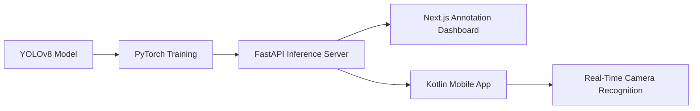

<div align="center">

[](https://git.io/typing-svg)

<p>
  <a href="https://linkedin.com/in/ziad-khalil-821277248">
    
  </a>
  <a href="mailto:ziadk432@hotmail.com">
    
  </a>
  <a href="https://github.com/ziadk432">
    
  </a>
</p>


</div>

---

## `whoami`

```ts
const ziad = {
  location: "Cairo, Egypt",
  role: "Software Engineer",
  experience: "2+ years shipping production software",

  focus: [
    "Frontend Architecture",
    "Full-Stack Applications",
    "SaaS Platforms",
    "Performance & Accessibility",
  ],

  currentlyBuildingWith: [
    "React",
    "Next.js",
    "TypeScript",
    "Node.js",
    "Strapi",
  ],

  engineeringValues: [
    "Maintainable code",
    "Thoughtful user experiences",
    "Strong performance",
    "Clear architecture",
  ],
};
```

I build production SaaS platforms, booking systems, internal dashboards and customer-facing digital products.

My work spans the full development journey—from shaping product flows and building demo interfaces to designing reusable component systems, typed API layers, authentication architecture and deployment workflows.

---

## Impact at a Glance

<div align="center">

|           **100K+**           |           **38M EGP**          |               **400+**               |            **4 Languages**           |
| :---------------------------: | :----------------------------: | :----------------------------------: | :----------------------------------: |
| Users served by SparkPlatform | Processed through the platform | Items supported in a workflow engine | Arabic, English, Turkish and Russian |

|       **3 Gateways**       |   **5 Repositories**  |            **95%+**            |        **3 User Flows**        |
| :------------------------: | :-------------------: | :----------------------------: | :----------------------------: |
| Stripe, Moyasar and Paymob | Eventbeez NX monorepo | Lighthouse performance targets | Built solo for The Boat Market |

</div>

---

## Featured Work

<table>
<tr>
<td width="50%" valign="top">

### 🔍 Inspkt

A multi-tenant B2B inspection and booking SaaS platform.

**What I built**

* Three-tier role-based access control
* Stripe, Moyasar and Paymob integrations
* Subscription guards and protected workflows
* Drag-and-drop workflow engine
* Optimized management of 400+ items
* BFF authentication with secure cookie sessions

**Stack**

`Next.js` `TypeScript` `Zustand` `TanStack Query` `Payments`

<br/>

[](https://inspkt.eg)

</td>
<td width="50%" valign="top">

### 🎟️ Eventbeez

An event management SaaS platform powering attendee and organizer experiences.

**What I built**

* Customer-facing event experiences
* Internal event management dashboards
* Multi-step abstract submission system
* Local-storage form persistence
* Payment and subscription functionality
* Shared architecture across a five-repository NX monorepo

**Stack**

`React` `Next.js` `TypeScript` `NX` `REST APIs`

<br/>

[](https://eventbeez.com)

</td>
</tr>

<tr>
<td width="50%" valign="top">

### ⛵ The Boat Market

A marine marketplace built independently across the frontend and backend.

**What I built**

* Three distinct customer journeys
* Boat sale and rental listing flows
* Full CMS and administration dashboard
* Structured listing and enquiry system
* Strapi headless CMS integration
* Full-stack deployment on Fly.io

**Stack**

`Next.js` `TypeScript` `Strapi` `PostgreSQL` `Fly.io`

<br/>

[](https://theboatmarket.co)

</td>
<td width="50%" valign="top">

### 🏆 SparkPlatform

An activity-booking platform serving over 100,000 users and processing more than 38 million EGP.

**What I built**

* Tournament management dashboard
* Bracket generation for 8–32 teams
* Match scheduling workflows
* Leaderboard management
* Tournament administration interfaces
* Reusable complex form components

**Stack**

`React` `Next.js` `TypeScript` `TanStack Query`

<br/>

[](https://apessolutions.com)

</td>
</tr>

<tr>
<td width="50%" valign="top">

### 🚤 Egypt International Boat Show

An event management and booking platform created for the Egypt International Boat Show.

**What I built**

* Dynamic survey builder
* Custom question-builder interface
* Conditional branching logic
* Flexible attendee journeys
* Booking and event-management workflows

**Stack**

`Next.js` `TypeScript` `Dynamic Forms` `REST APIs`

<br/>

[](https://egyptboatshow.co)

</td>
<td width="50%" valign="top">

### 🏙️ Views Properties

A multilingual real-estate platform rebuilt from a legacy client-rendered application.

**What I built**

* CSR-to-SSR/SSG migration
* Arabic RTL support
* English, Turkish and Russian localization
* Reusable Atomic Design components
* SEO and Core Web Vitals improvements

**Stack**

`Next.js` `TypeScript` `next-intl` `SSR` `SSG`

<br/>

[](https://views.properties)

</td>
</tr>
</table>

---

## Technology Ecosystem

<div align="center">

### Frontend


### Backend, Data and CMS


### Tooling and Delivery


<br/>

`TanStack Query` · `Zustand` · `SWR` · `Axios` · `NX Monorepos`
`Strapi` · `Payload CMS` · `Drizzle ORM` · `Framer Motion` · `GSAP`
`React Three Fiber` · `Storybook` · `CI/CD` · `Core Web Vitals`

</div>

---

## GitHub Analytics

<div align="center">

<p>
  
  
</p>


<br/><br/>


</div>

---

## How I Build

```text
Understand the product
        ↓
Shape the user journey
        ↓
Design the architecture
        ↓
Build reusable foundations
        ↓
Ship, measure and optimize
```

I care about more than making an interface work. I focus on:

* Architecture that remains understandable as products grow
* Reusable components that accelerate future development
* Typed API layers that reduce integration errors
* Secure authentication and session handling
* Fast loading, accessibility and strong Core Web Vitals
* Product flows that feel clear to real users

---

## Beyond Traditional Frontend Work

My experience also includes:

* Docker-based deployment workflows
* CI/CD pipelines
* Supabase and PostgreSQL
* Node.js and FastAPI services
* Strapi and Payload CMS
* Mistral LLM integrations
* Interactive Three.js product experiences
* React Three Fiber and React Three Drei
* Analytics using GTM and Hotjar

---

## Education and Research

### B.Sc. Computer Science — German University in Cairo

**Grade: A**

My graduation project explored real-time object detection for faster retail data acquisition.

The end-to-end system combined:



---

## Currently Exploring

```js
const currentInterests = [
  "Scalable full-stack TypeScript systems",
  "System design and backend architecture",
  "AI-enabled product experiences",
  "Developer tooling and automation",
  "High-performance web applications",
];
```

---

## Let’s Build Something Meaningful

I'm interested in opportunities where I can contribute to real products, collaborate with strong engineering teams and continue growing across frontend, backend and system architecture.

<div align="center">

[](https://linkedin.com/in/ziad-khalil-821277248)
[](mailto:ziadk432@hotmail.com)

<br/><br/>

### Building software that is fast, thoughtful and made to last.

</div>


